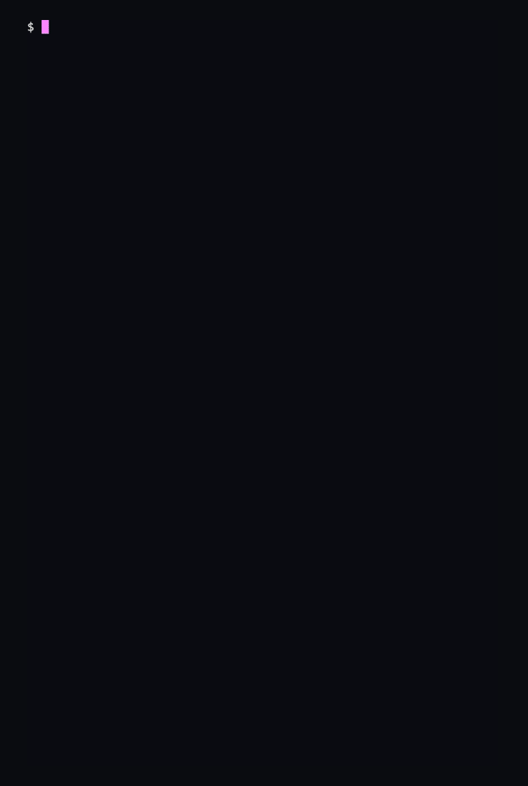
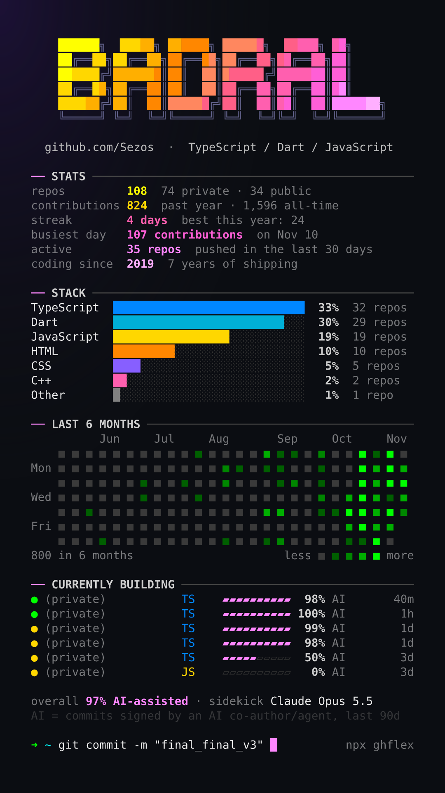

<div align="center">

# ghflex

Your whole GitHub in one screenshot. Stats, stack, streak, and how much of it AI wrote.

[](https://www.npmjs.com/package/ghflex)
[](LICENSE)


&nbsp;&nbsp;


</div>

## Try it in 5 seconds

```bash
npx ghflex
```

Peek at anyone's public card:

```bash
npx ghflex torvalds
```

ghflex uses your GitHub CLI login (`gh auth login`) or a `GITHUB_TOKEN`. If you have neither, it asks for a token once and saves it so only you can read it. Needs Node 22 or newer.

## Or let your AI do it

Paste this into Claude Code, Cursor, or Codex:

```text
Set up ghflex for me: https://github.com/Sezos/ghflex/blob/main/AGENTS.md
```

[AGENTS.md](AGENTS.md) walks your AI through checking Node, logging into GitHub, running the card, and adding a shell alias.

## Post it

```bash
npx ghflex --story --hide-private
```

`--story` saves `ghflex-story.png` (1080×1920) in the current folder, ready for an Instagram story.

Prefer a screenshot? Make your terminal narrow and tall (about 60 columns wide), use a dark theme, and zoom in a couple of steps so it reads well on a phone.

## Options

| Usage                   | What it does                                                        |
| ----------------------- | ------------------------------------------------------------------- |
| `npx ghflex`            | your card (includes private repos your token can see)               |
| `npx ghflex <username>` | someone else's card, public data only                               |
| `--banner "text"`       | custom banner text (A–Z and spaces)                                 |
| `--hide-private`        | replaces private repo names with `(private)`; counts and stats stay |
| `--story`               | also saves `ghflex-story.png` (1080×1920)                           |
| `--theme <name>`        | color theme: `neon` (default), `sunset`, `matrix`                   |
| `--fast`                | skip the reveal animation                                           |
| `--no-clear`            | don't clear the screen first                                        |
| `--logout`              | delete the token ghflex saved                                       |

## How the AI meter works

ghflex reads your commits from the last 90 days, on each repo's default branch, and sorts them into three buckets:

- **you + AI**: commits you made that carry an AI co-author trailer (`Co-Authored-By: Claude …`, Copilot, Cursor, Aider) or a "Generated with …" marker
- **AI agent**: commits made by an AI agent account (Copilot coding agent, Devin, Jules, Codex, Claude) in repos you own
- **you**: everything else

Each repo in "Currently building" shows its AI share. The overall line shows the total, plus the AI co-author that shows up most: your "sidekick".

The honest limits:

- **It's a floor, not a guess.** Only signed commits count. Inline autocomplete leaves no trace in git, so it's never counted.
- **Co-authors are matched by email, never by name**, so a teammate called Claude stays human.
- **Commits under an email that isn't verified on your GitHub account can't be linked to you**, so they're missed. Add your other emails at [github.com/settings/emails](https://github.com/settings/emails).
- **It counts commits, not lines.** Lockfiles and generated code would skew a line count.
- **For speed,** a repo's share comes from your 300 most recent commits in the window, and ghflex reads at most 60 repos. The card's footnote tells you when it hit that cap.

## Privacy

- **Everything runs on your machine.** ghflex talks only to GitHub's API (`api.github.com/graphql`) and sends no telemetry.
- **Your token stays private.** It's never printed. A token you paste is saved to `~/.config/ghflex/token` (on Windows, `%APPDATA%\ghflex\token`), readable only by you. `ghflex --logout` deletes it.
- **Peeking at someone else** only ever reads their public data.

## Add an AI tool

Every AI signature lives in [`src/ai/signatures.json`](src/ai/signatures.json): co-author emails, commit-message markers, and agent account names. If your tool signs its commits and ghflex misses it, add one line there and open a PR. Link a real commit or the tool's docs that show the signature.

## License

[MIT](LICENSE)
